<p align="center">
  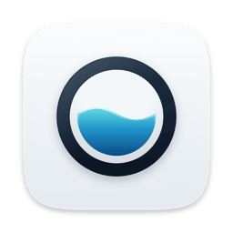
</p>

<h1 align="center">
  <picture>
    <source media="(prefers-color-scheme: dark)" srcset="docs/images/ebb-wordmark-dark.svg">
    
  </picture>
</h1>

<p align="center">A macOS menu bar app for CLIProxyAPI: how much of your pooled Claude Code and Codex limits is left.</p>

<p align="center">
  <a href="https://github.com/lucasnsaraujo/ebb/releases/latest"></a>
  
  <a href="LICENSE"></a>
  <a href="#install"></a>
</p>

<p align="center">
  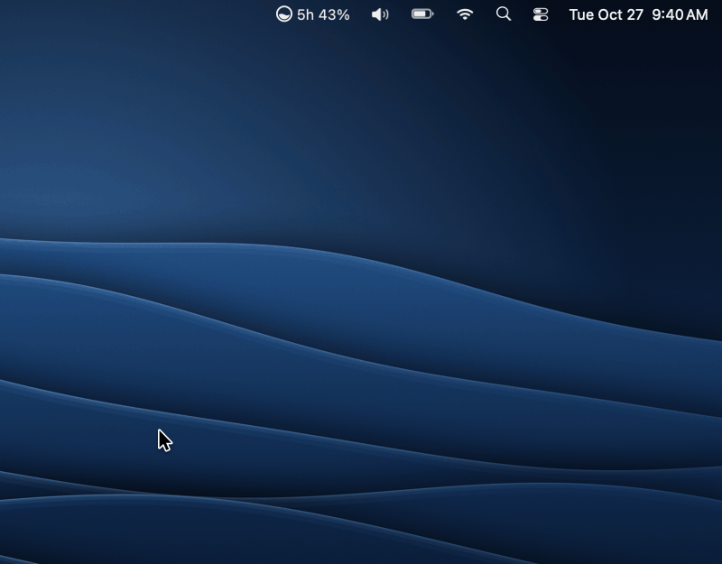
</p>

<table>
  <tr><th></th><th>Light</th><th>Dark</th></tr>
  <tr>
    <td>Panel</td>
    <td>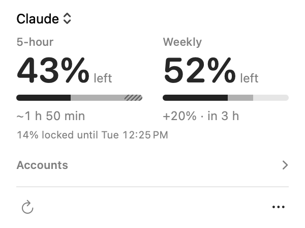</td>
    <td>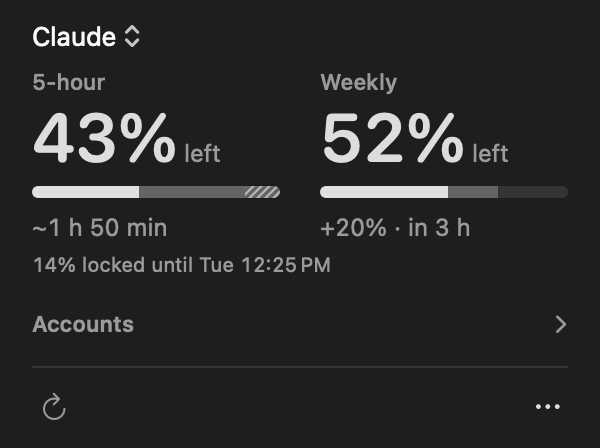</td>
  </tr>
  <tr>
    <td>Accounts</td>
    <td>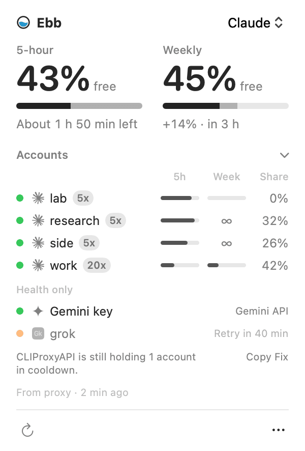</td>
    <td>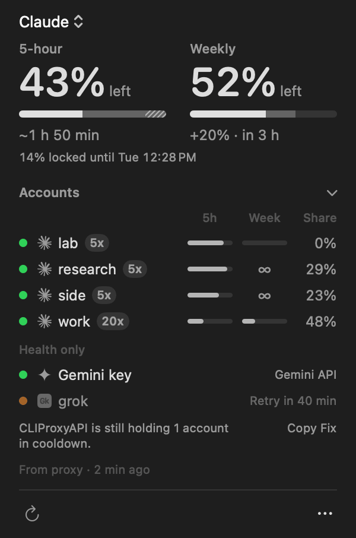</td>
  </tr>
  <tr>
    <td>Pace on hover</td>
    <td>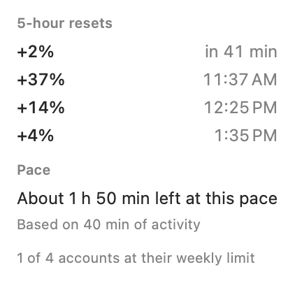</td>
    <td>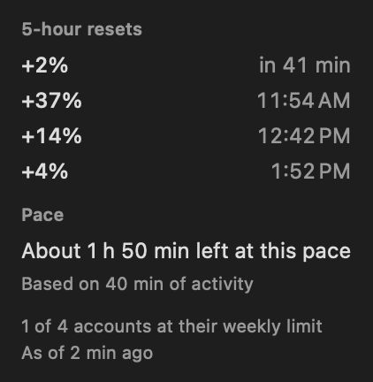</td>
  </tr>
  <tr>
    <td>First run</td>
    <td>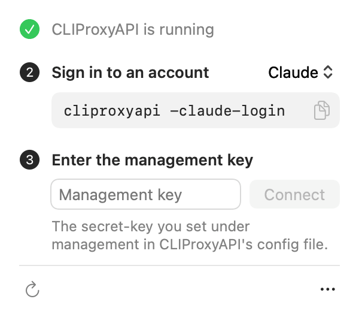</td>
    <td>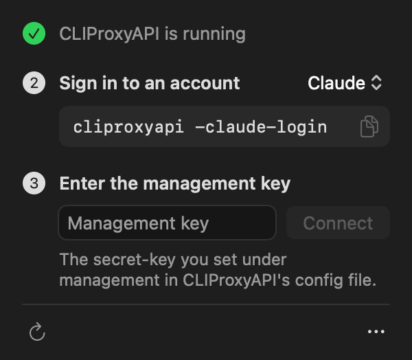</td>
  </tr>
  <tr>
    <td>Settings</td>
    <td>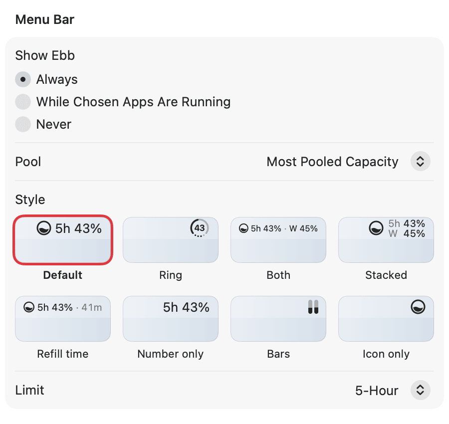</td>
    <td>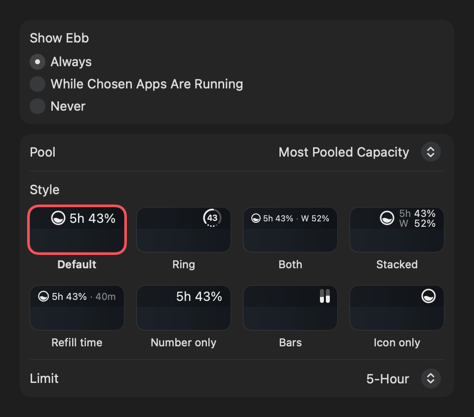</td>
  </tr>
  <tr>
    <td>Routing</td>
    <td>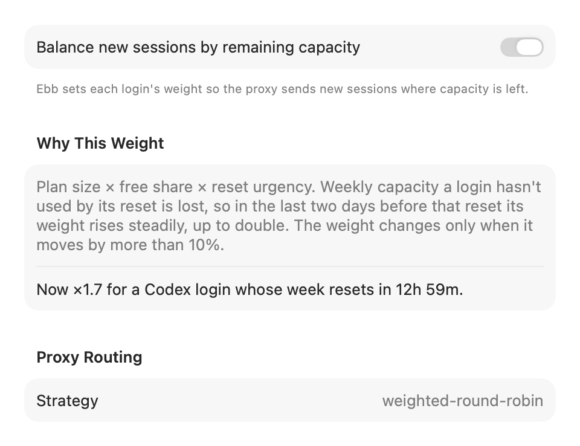</td>
    <td>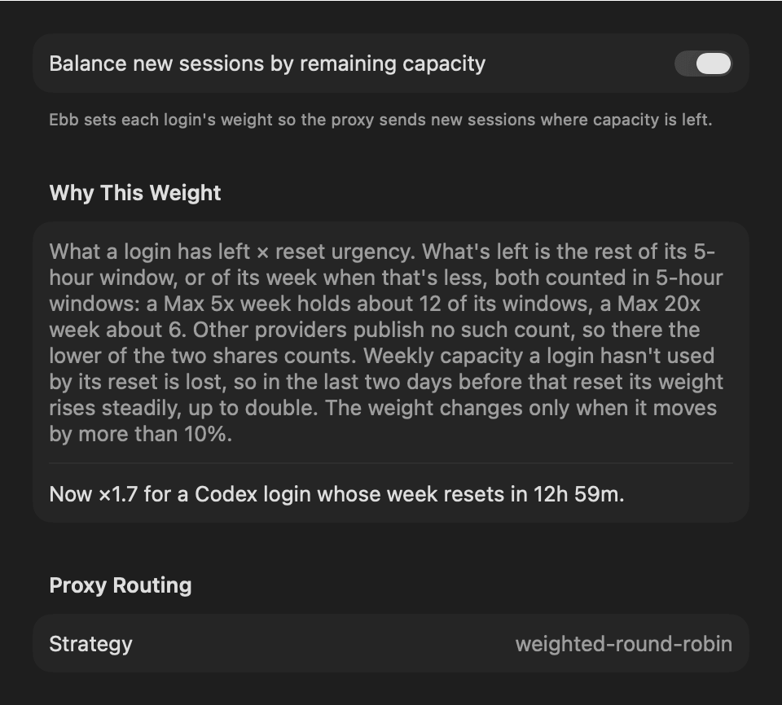</td>
  </tr>
  <tr>
    <td>Menu bar styles</td>
    <td colspan="2">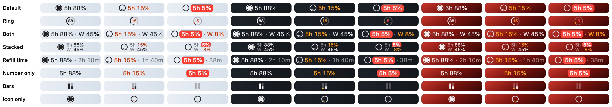</td>
  </tr>
</table>

[CLIProxyAPI](https://github.com/router-for-me/CLIProxyAPI) (CLI Proxy API) pools several Claude Code, Codex and other coding-agent subscriptions behind one local endpoint. It spreads requests across those accounts but doesn't tell you how much is left. Ebb shows that in the menu bar: the free share of the pool's 5-hour limit and of its weekly limit, each weighted by plan size, so a Max 20x account counts four times a Max 5x one.

## What it shows

- **5-hour and weekly limits, in one number each.** Per provider, never added across providers: a Claude 5-hour share and a Codex one are different allowances. An account that has spent its week counts as no 5-hour capacity, since it can't serve any.
- **When it runs out, Battery style.** "About 2 h left" for the 5-hour window, "Runs out ~Thu 14:00" for the weekly one, only when the pool is draining faster than it refills. Hovering shows the pace, including "Lasts until reset". The 5-hour pace is your recent rate while you work, idle time left out; the weekly pace is your usual rhythm over the last week. The weekly card also gives a daily share that lasts until the next meaningful reset: "About 14% a day lasts until Tue 22:00".
- **What comes back, and when.** A refill line under each meter, such as "+14% · in 3 h" for the weekly window, and an optional notification when weekly capacity returns ("Claude weekly back +55%").
- **A nudge before capacity goes to waste.** A notification once per weekly reset, when a fifth or more of a pool is about to reset unused within a day: "Claude: 40% of this week's pool resets unused tomorrow 22:00".
- **Every account in the pool.** The accounts list shows each login's 5-hour and weekly bars, plan badge and share of the pool, plus health-only logins (API keys, providers without quota data) with their status and cooldown.
- **Provider incidents.** While Claude's or OpenAI's status page reports a problem with what a pool runs on, the panel shows one line such as "Claude: degraded performance", linked to the page.

## Auto-tuned routing weights

Ebb sets each login's routing weight in CLIProxyAPI to plan size × free share × reset urgency, so new sessions go where capacity is left and each provider's accounts drain evenly. Weekly capacity a login hasn't used by its reset is lost, so in the last two days before that reset its weight rises steadily, up to double. Weights only take effect with the proxy's weighted round robin strategy; Settings → Routing shows the strategy, switches it with one click, and turns balancing off.

With a management key, Ebb also disables a login in CLIProxyAPI once its provider answers twice in a row that the plan has ended, and enables it again when the plan renews. It only touches logins it disabled itself; one you disabled by hand stays as you left it. Each change comes with a pool alert, as does a new login the first time it counts, named by plan only: "Claude: a Max 20x account left the pool", "Codex: a new Team account joined the pool".

When CLIProxyAPI still holds an account in cooldown although a fresh reading shows its quota is back, the accounts panel says so, with a Copy Fix button for the proxy's documented `reset-quota` call. Ebb never changes that state itself.

Ebb is in English and Brazilian Portuguese, following the language order in System Settings; times and numbers follow your region's formats. Every control is labeled for VoiceOver, and the panel honors Reduce Motion and Increase Contrast.

## Providers

| Provider | Windows | Source |
| --- | --- | --- |
| Claude (Pro, Max 5x, Max 20x) | 5-hour, weekly | Proxy quota signals; idle accounts from Anthropic's usage endpoint |
| Codex | 5-hour, weekly | Proxy quota signals; idle accounts from `wham/usage` through the proxy |
| Devin | daily, weekly | Proxy quota signals |
| Antigravity | 5-hour, weekly | `retrieveUserQuotaSummary` through the proxy |
| Kimi | 5-hour, weekly | `/coding/v1/usages` through the proxy |
| Meta Muse | 5-hour, weekly | `muse-code/key` through the proxy; shows "Limits not available" while the proxy can't send the device-code token |
| xAI, Vertex, Gemini API key, AI Studio, OpenAI-compatible, plugins | none | Health only: status and cooldown. Never counted in a pool. |

The usage endpoints Ebb reads for idle accounts are undocumented and can change without notice. Plan weights have defaults you can change in Settings → Plans. Missing a provider? [Request it](https://github.com/lucasnsaraujo/ebb/issues/new/choose).

## Install

Requires macOS 26 or later, on Apple silicon or Intel, and CLIProxyAPI.

**Homebrew**

```sh
brew install --cask lucasnsaraujo/tap/ebb
```

This also installs CLIProxyAPI from Homebrew if it's missing, and links the `ebb` command. The full name is how Homebrew 6 and later trust a single cask from a third-party tap.

**Download**

Get `Ebb-<version>.zip` from the [latest release](https://github.com/lucasnsaraujo/ebb/releases/latest), unzip it and move `Ebb.app` to Applications.

**First open of a download.** Ebb is open source and ad-hoc signed, not notarized by Apple, so the first time you open a downloaded copy macOS says it can't check it for malware. Click Done, then open System Settings → Privacy & Security, scroll to Security and click Open Anyway ([Apple's steps](https://support.apple.com/guide/mac-help/open-a-mac-app-from-an-unknown-developer-mh40616/mac)). That's needed once. The Homebrew cask and Ebb's own updates skip this step: both clear the download quarantine, the flag macOS checks. If you'd rather not trust a binary, [build it yourself](#build-from-source).

**Updates.** Ebb checks GitHub once a day and shows a new release with its notes; it installs when you click Install Update, or on its own if you tick automatic updates in that window. It only accepts a zip signed with the release key; see [docs/updates.md](docs/updates.md). Settings → General turns the daily check off.

## Connect to CLIProxyAPI

Ebb finds a local CLIProxyAPI through its config file and reads your accounts through the management API. Until the proxy runs and accepts a management key, the panel shows three setup steps in place of the pool:

1. **Install or start CLIProxyAPI.** `brew install cliproxyapi` with a Copy button, then a Start button for a Homebrew install (`brew services start cliproxyapi`) or the command to copy for any other.
2. **Sign in to an account** with CLIProxyAPI's own login command, such as `cliproxyapi -claude-login` or `cliproxyapi -codex-login`.
3. **Enter the management key**, the `remote-management.secret-key` from CLIProxyAPI's config. You can also put it in a `.management-key` file in CLIProxyAPI's logins folder; Ebb reads it from there until you press Forget Key.

Ebb never writes CLIProxyAPI's config file or login files, so installing and signing in stay commands for you to run. Through the management API it changes only routing weights and the disabled flag of logins whose plan ended (see [Auto-tuned routing weights](#auto-tuned-routing-weights)). With Claude logins already readable, Continue Without a Key skips the key. Later, if the proxy stops, the panel says so and offers to start it again.

Claude works without a key: Ebb reads the Claude logins in the logins folder directly. Everything else needs one. Calls "through the proxy" go through CLIProxyAPI's `api-call` endpoint, where Ebb names the account and the proxy fills in its token, so Ebb never reads those tokens.

For CLIProxyAPI on another machine, set its management URL in Settings → Connection. Ebb then reads every login, Claude's included, from the proxy's listing and `api-call`, and never touches a logins folder. Use https; plain http is accepted only on a private network, and the key then crosses it unencrypted. Over plain http Ebb first checks that the address answers like CLIProxyAPI 7.3.4 or later, so a different network's router that holds the same private address never gets the key.

## Command line

Settings → General → Install Command Line Tool puts an `ebb` command on your PATH (the Homebrew cask links it for you). `ebb status` prints every pool, `ebb status --json` prints the same in a [documented schema](docs/cli.md#json-schema), and `ebb statusline` prints one line such as `5h 88% · W 45%`. Use that line in your shell prompt or in Claude Code's status line:

```json
{
  "statusLine": { "type": "command", "command": "ebb statusline", "refreshInterval": 60 }
}
```

The command reads the numbers the app already saved and never touches the network. `ebb --uninstall-data` is the one command that changes anything: it lists Ebb's settings, caches, saved key and command link, asks, and removes them, but never CLIProxyAPI's files or `Ebb.app` ([exact paths](docs/paths.md)). See [docs/cli.md](docs/cli.md).

## Shortcuts and Siri

Ebb adds two actions to Shortcuts, Spotlight and Siri. **Get Pool Status** returns a provider's 5-hour (or daily) and weekly free share and its next refill, as separate values; leave the provider empty for the pool the menu bar shows. **Open Ebb** opens the panel. Say "Check my Ebb pool" or "Get Codex pool status in Ebb". Like the command, both use the numbers Ebb already has.

## Privacy

Ebb has no telemetry, no analytics and no server of its own. It talks to:

- your CLIProxyAPI, normally on `localhost`;
- Anthropic's usage and profile endpoints, for idle Claude accounts and their plan, with that account's own token;
- `status.claude.com` and `status.openai.com`, at most every 5 minutes while the menu bar item shows, with no account data;
- GitHub, once a day, to check for a new release.

The management key is stored in a file only your user can read, and is never logged. On its first launch Ebb adds itself as a login item, and macOS shows a notice; Settings → General → Launch at login turns it off. It asks for no other permission at launch: notifications are requested the first time an alert is due. [SECURITY.md](SECURITY.md) lists the files Ebb writes and how to report a vulnerability; [docs/paths.md](docs/paths.md) has their exact paths, for removing Ebb completely or for the Homebrew cask's `zap`. The ··· menu's Copy Diagnostics puts versions, account states and recent events on the clipboard for a bug report, with keys, tokens, emails and file names left out.

## FAQ

**Ebb doesn't appear in the menu bar.** On macOS 26 and later, check System Settings → Menu Bar and make sure Ebb is allowed. Ebb can also hide itself on purpose: Settings → General → Show Ebb can be set to only while chosen apps run.

**The numbers look stale.** CLIProxyAPI reports quota as accounts serve requests. An idle account is read from its provider's usage endpoint at a slower pace, so it can lag by a few minutes. The panel says how old each reading is.

**Do the plan weights match what Anthropic and OpenAI actually give?** No one publishes exact sizes. The defaults follow the plan names (Max 20x weighs four times Max 5x); change them in Settings → Plans if your accounts behave differently.

**How is Ebb different from Quotio or CodexBar?** [Quotio](https://github.com/nguyenphutrong/quotio) manages CLIProxyAPI itself: it runs the proxy and its accounts. [CodexBar](https://github.com/steipete/CodexBar) reads many providers directly, without a proxy. Ebb doesn't run the proxy; it shows how much of the whole pool is free and how long it lasts, and tunes the pool's routing weights.

**Does Ebb send my usage anywhere?** No. See [Privacy](#privacy).

## Build from source

Requires Xcode 26 or later.

```sh
./build.sh      # builds a universal Ebb.app and installs it to ~/Applications, with the ebb command and App Intents metadata
swift test      # runs the unit tests
```

`./build.sh --bundle <dir>` only writes `Ebb.app` into `<dir>`. Releases and updates are described in [docs/updates.md](docs/updates.md).

Measured on a macOS 26 CI runner over 60 s idle against a stand-in proxy: a 4.6 MB single-architecture binary (the shipped app is universal, about twice that), 13–14 MB physical footprint, 0.02–0.09% CPU once launched, 9–10 network requests and 8 timer wakes, and none of either while the item is hidden. Sparkle and the login item only start inside the app bundle, so the budget doesn't cover them. `scripts/check-budget.sh` is the lightweight budget CI runs; it launches Ebb with `--budget-report <file> --budget-seconds 60`, once with `--hidden`, so run it only in a disposable session. `Ebb --demo` shows fake accounts of every provider with no network, for screenshots and testing. `Ebb --snapshot <dir>` renders the panel, every menu bar style and Settings → General, Routing and Connection offscreen to PNGs and quits; add `--demo` for the fake accounts. `Ebb --record <dir>` renders the README hero offscreen from the fake accounts, plus the demo video's frames in `frames/` (60 fps) and the GIF's in `gif-frames/` (20 fps) for ffmpeg, and quits.

## Contributing

Bug reports and provider requests are welcome; open an issue first for anything bigger than a small fix. See [CONTRIBUTING.md](CONTRIBUTING.md).

## License

MIT. Ebb is not affiliated with Anthropic, OpenAI, Cognition, Google, Moonshot AI, Meta or the CLIProxyAPI project. Provider names and logos are trademarks of their owners; see [THIRD_PARTY.md](THIRD_PARTY.md).
